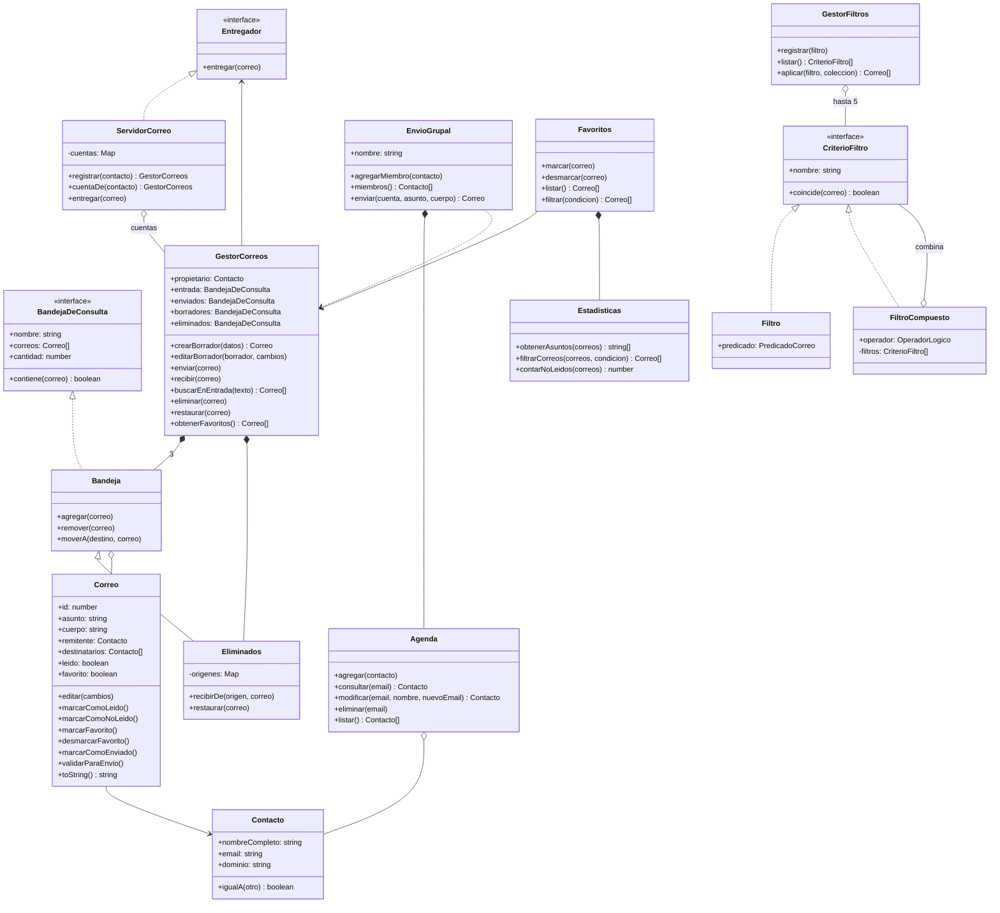

# IntegradorAE4

## Gestor de Correos Electrónicos con Filtros Dinámicos

Trabajo Práctico Integrador (AE4) de Paradigmas y Lenguajes de Programación II (UCP).

Simula un sistema de correo: cada usuario tiene su cuenta con cuatro bandejas (Entrada, Enviados, Borradores y Eliminados), y un servidor entrega los correos entre cuentas. Incluye contactos, borradores, búsqueda, favoritos y filtros dinámicos.
El dominio está modelado con **Programación Orientada a Objetos** y los filtros y el procesamiento de colecciones con **Programación Funcional**, en TypeScript con tipado estricto.

---

## Cómo ejecutarlo

Requisitos: Node.js 20 (o 18+) y Git.

```bash
git clone https://github.com/maurormrz/IntegradorAE4
cd IntegradorAE4
npm ci                  # instala las dependencias exactas del lockfile
npm run compilar        # compila con tsc (sin generar archivos)
npm test                # ejecuta todas las pruebas
npm run test:coverage   # pruebas + tabla de cobertura (100 %)
```

Para ver el flujo completo en un solo lugar: `npx jest tests/Escenario.test.ts --verbose`.

---

## Estructura

```
src/                        tests/
  Contacto.ts                 Contacto.test.ts
  Agenda.ts                   Agenda.test.ts
  Correo.ts                   Correo.test.ts
  Bandeja.ts                  Bandeja.test.ts
  Eliminados.ts               Eliminados.test.ts
  GestorCorreos.ts            GestorCorreos.test.ts
  ServidorCorreo.ts           ServidorCorreo.test.ts
  Predicados.ts               Predicados.test.ts
  Filtro.ts                   Filtro.test.ts
  FiltroCompuesto.ts          FiltroCompuesto.test.ts
  GestorFiltros.ts            GestorFiltros.test.ts
  Estadisticas.ts             Estadisticas.test.ts
  adicionales/                Escenario.test.ts   (historia completa)
    EnvioGrupal.ts            adicionales/
    Favoritos.ts                EnvioGrupal.test.ts
                                Favoritos.test.ts
```

---

## Diagrama de clases (UML)



`Predicados.ts` no es una clase: es un módulo de funciones. Define el tipo `PredicadoCorreo = (correo) => boolean`, los operadores de orden superior `and`, `or` y `not`, los predicados simples (`deDominio`, `asuntoIncluye`, `cuerpoIncluye`, `esNoLeido`, `esFavorito`, `remitenteEs`) y `coincideConTexto` para la búsqueda.

---

## Decisiones de diseño

- **Una cuenta por usuario.** `GestorCorreos` es la cuenta de una persona, con sus cuatro bandejas. `ServidorCorreo` registra las cuentas (una por email) y entrega los correos. El remitente de un borrador es siempre el dueño de la cuenta, también al editarlo.
- **Cada destinatario recibe su propia copia.** La copia tiene el mismo contenido, pero otro `id` y su propio estado de leído y favorito. Así un correo está siempre en una sola bandeja: si Luis elimina su copia o Sofía lee la suya, las demás no cambian.
- **Bandejas de solo consulta.** Desde afuera, las bandejas de una cuenta se ven como `BandejaDeConsulta` (sin `agregar` ni `remover`). Los correos solo se mueven con las operaciones de la cuenta, que validan las reglas.
- **Un correo enviado o recibido ya no se edita.** Al enviarlo o recibirlo, el correo queda marcado como enviado y `editar` lanza un error. Se puede seguir marcando como leído o favorito. Así nadie cambia un mensaje después de enviado, ni siquiera llamando a `Correo.editar` directamente.
- **Eliminados recuerda el origen.** `Eliminados` guarda de qué bandeja salió cada correo y lo restaura ahí. Un correo eliminado conserva su marca de favorito, pero no aparece en `obtenerFavoritos()` hasta que se restaura.
- **Los filtros no guardan correos.** Evalúan la colección en el momento en que se aplican. Por eso un cambio (por ejemplo, marcar como leído) se ve enseguida en el resultado.
- **El nombre identifica al filtro.** `GestorFiltros` registra hasta cinco filtros y no acepta dos con el mismo nombre.
- **El envío no deja estados a medias.** Primero se valida todo (bandeja de origen, remitente, datos y que existan las cuentas de los destinatarios), después se entrega y recién entonces el correo pasa a Enviados.

### Movimientos permitidos entre bandejas

| Operación        | Desde                          | Hacia                                                     | Si no se cumple                                                            |
| ---------------- | ------------------------------ | --------------------------------------------------------- | -------------------------------------------------------------------------- |
| `crearBorrador`  | —                              | Borradores                                                | —                                                                          |
| `editarBorrador` | Borradores                     | Borradores                                                | error: solo se editan borradores; un correo enviado o recibido no se edita |
| `enviar`         | Borradores o correo nuevo      | Enviados (y una copia en la Entrada de cada destinatario) | error si está en Entrada, Enviados o Eliminados                            |
| `recibir`        | servidor                       | Entrada                                                   | error si el correo ya está en alguna bandeja de la cuenta                  |
| `eliminar`       | Entrada, Enviados o Borradores | Eliminados                                                | error si ya está eliminado o no está en la cuenta                          |
| `restaurar`      | Eliminados                     | la bandeja de origen                                      | error si no está en Eliminados                                             |

### Principios SOLID

| Principio                        | Dónde se aplica                                                                                                                                                                                             |
| -------------------------------- | ----------------------------------------------------------------------------------------------------------------------------------------------------------------------------------------------------------- |
| **S**: responsabilidad única     | `Eliminados` solo recuerda orígenes y restaura. `ServidorCorreo` solo registra y entrega. `GestorCorreos` maneja una cuenta. `Estadisticas` procesa colecciones. `GestorFiltros` registra y aplica filtros. |
| **O**: abierto/cerrado           | Para agregar un tipo de filtro nuevo alcanza con implementar `CriterioFiltro`; `GestorFiltros` no se modifica (así se agregó `FiltroCompuesto`).                                                            |
| **L**: sustitución de Liskov     | Un `FiltroCompuesto` se usa en cualquier lugar donde va un `Filtro`. `Eliminados` se usa como cualquier `Bandeja`.                                                                                          |
| **I**: segregación de interfaces | Interfaces chicas: `BandejaDeConsulta` (solo consultar), `CriterioFiltro` (`nombre` y `coincide`) y `Entregador` (solo `entregar`).                                                                         |
| **D**: inversión de dependencias | `GestorCorreos` depende de la interfaz `Entregador` y la recibe por constructor. En sus tests se usa un entregador de prueba, y en el sistema real, `ServidorCorreo`.                                       |

---

## Requerimientos y dónde se prueban

| RF                     | Dónde                                                                                                    |
| ---------------------- | -------------------------------------------------------------------------------------------------------- |
| RF-01 Correos          | `Correo.test.ts`                                                                                         |
| RF-02 Envío            | `GestorCorreos.test.ts`, `ServidorCorreo.test.ts`, `adicionales/EnvioGrupal.test.ts`                     |
| RF-03 Contactos        | `Contacto.test.ts`, `Agenda.test.ts`                                                                     |
| RF-04 Búsqueda         | `Predicados.test.ts`, `GestorCorreos.test.ts`                                                            |
| RF-05 Filtros          | `Predicados.test.ts`, `Filtro.test.ts`, `FiltroCompuesto.test.ts` (100 correos), `GestorFiltros.test.ts` |
| RF-06 Bandejas         | `Bandeja.test.ts`, `Eliminados.test.ts`, `GestorCorreos.test.ts`, `ServidorCorreo.test.ts`               |
| RF-07 Borradores       | `GestorCorreos.test.ts`                                                                                  |
| RF-08 Leído / no leído | `Correo.test.ts`, `GestorCorreos.test.ts`, `ServidorCorreo.test.ts`                                      |
| RF-09 Favoritos        | `GestorCorreos.test.ts`, `adicionales/Favoritos.test.ts`                                                 |
| RF-10 Estadísticas     | `Estadisticas.test.ts` (`map`, `filter` y `reduce`)                                                      |

### Escenario completo (`tests/Escenario.test.ts`)

1. Ana envía un correo a Luis, Sofía y Marcos, y queda en la Entrada de cada uno (`toString()` muestra de quién a quién va).
2. Luis elimina su copia y las de Sofía y Marcos no cambian.
3. Luis la restaura a su Entrada.
4. Sofía lee su copia: solo cambia la de ella, y el filtro de pendientes lo refleja en el momento.
5. Se registran cinco filtros (simples y compuestos); un sexto da error.
6. Marcos recibe 100 correos y el filtro compuesto "Exámenes UCP sin leer" encuentra exactamente los que corresponden.
7. Marcos elimina uno: sale de la Entrada y el mismo filtro lo encuentra en Eliminados.

---

## Integración continua

`.github/workflows/ci.yml` corre en cada push y pull request a `main`: instala con `npm ci`, **compila** con `npm run compilar` y **ejecuta las pruebas** con `npm test`.

## Metodología

Desarrollo guiado por pruebas (TDD): primero el test que falla, después el código mínimo que lo hace pasar, y por último el refactor. La cobertura es del 100 %, y los tests se verificaron rompiendo el código a propósito (mutaciones manuales) para confirmar que fallan.
